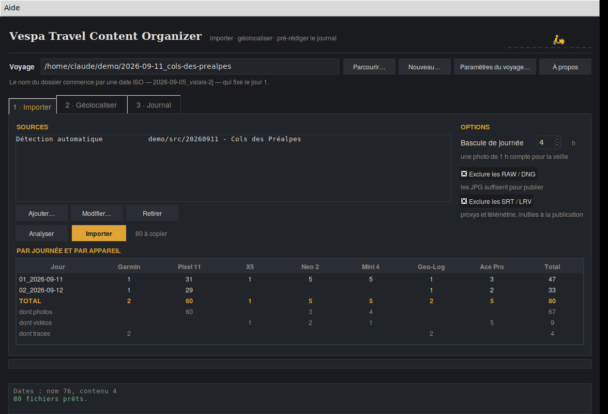

# Vespa Travel Content Organizer

Application de bureau qui range, géolocalise et documente les médias d’un roadtrip
à Vespa. Elle répond à un problème précis : un voyage de deux jours produit déjà
de la matière issue de six ou sept appareils, un voyage de deux mois la produit
soixante fois, et le tri manuel du soir est la première chose qu’on abandonne.



Python 3.9 et Tkinter seuls, aucune dépendance. Un seul fichier source.
Sous Windows, elle se compile en un exécutable portable.

---

## Ce qu’elle fait

**1 · Importer.** Vous désignez le dossier du voyage et vos sources. L’analyse
lit chaque fichier, en déduit la journée de voyage et l’appareil d’origine, et
affiche le décompte par journée et par appareil avant d’écrire quoi que ce soit.

**2 · Géolocaliser.** Elle applique la trace GPX de la montre aux fichiers sans
coordonnées, et sait proposer une correction d’horloge quand un appareil a dérivé.

**3 · Journal.** Elle construit le brouillon du jour à partir des waypoints du
carnet de terrain, en listant sous chacun les médias capturés au même moment.

## Le principe

Deux règles gouvernent tout le reste :

- **L’unité est la journée**, pas l’appareil. La publication, le journal et la
  trace fonctionnent tous par journée.
- **Ce que vous n’avez pas emporté n’existe pas.** Les paramètres du voyage
  listent le matériel, les logiciels et les réseaux ; ce qui n’est pas coché
  n’apparaît ni à l’ingestion, ni dans l’arborescence, ni dans les statistiques.

L’arborescence produite, avec un dossier numéroté de façon fixe par appareil :

```
2026-09-11_cols-des-prealpes/
  trip.md
  01_2026-09-11/
    01_GARMIN/
    02_PIXEL11/         PHOTO/  VIDEO/
    03_INSTA360_X5/     PHOTO/  VIDEO/
    04_INSTA360_ACEPRO2/VIDEO/
    05_DJI_NEO2/        PHOTO/  VIDEO/
    06_DJI_MINI4PRO/    PHOTO/  VIDEO/
    08_GEOLOG/
    30_PUBLICATION/     WHATSAPP/  INSTAGRAM_FACEBOOK/
  02_2026-09-12/
```

Les trous dans la numérotation sont normaux : ils disent quel matériel est resté
à la maison. Un sous-dossier `PHOTO` ou `VIDEO` n’est créé que s’il reçoit
réellement des fichiers.

## Quelques garde-fous

- **Elle copie, elle ne déplace jamais**, et ignore les fichiers déjà présents à
  l’identique : relancer une analyse par précaution ne coûte rien.
- **Rien n’est rangé au hasard.** Un fichier qu’elle ne sait pas attribuer est
  refusé et listé, jamais placé faute de mieux.
- **Les traces et carnets sont datés par leur contenu**, pas par la date du
  fichier — un export fait au retour se rangerait sinon hors du voyage.
- **Les dossiers `_Rejected`** de FastRawViewer et les corbeilles système sont
  ignorés : sans cela, les photos écartées reviendraient à l’import.
- **Les RAW/DNG et les fichiers annexes** (`.lrv`, `.srt`, `.thm`) sont écartés
  par défaut. Deux cases permettent de les réintégrer.

## Mode automatique

Si vos dossiers de travail portent des noms parlants — `Mini 4 Pro`, `Neo 2`,
`Ace Pro 2`, `X5`, `Pixel`, `Garmin`, `Geo-Log` —, ajoutez simplement la racine
du voyage comme source unique en détection automatique. L’application remonte
toute la chaîne de dossiers, y compris un `X5/EXPORTS`, et range chaque fichier
chez le bon appareil. Le nom du dossier l’emporte sur l’extension et sur l’EXIF,
ce qui sépare au passage le GPX de la montre de celui du carnet de terrain.

## Installation

```
python3 vespa_organizer.py
```

Sous Windows, `Vespa Organizer.bat` lance l’application, et `build_windows.bat`
la compile en exécutable portable unique via PyInstaller.

**exiftool** est optionnel mais recommandé : sans lui, les dates de prise de vue
des vidéos sont moins fiables et l’écriture des coordonnées est impossible.

| Système | Installation d’exiftool |
|---|---|
| macOS | `brew install exiftool` |
| Linux | `sudo apt install libimage-exiftool-perl` |
| Windows | exiftool.org, renommer `exiftool(-k).exe` en `exiftool.exe` |

## Diagnostic

L’application tient un journal technique dans `~/.vespa-organizer/diagnostic.log`,
limité à 1 Mo avec une génération conservée : versions, étapes de traitement et
erreurs avec leur trace. Le menu **Aide → Exporter le journal de diagnostic…**
rassemble le tout dans un fichier daté.

## Documentation

- [Guide rapide](docs/guide-rapide.pdf) — mode d’emploi complet de l’application
  ([version Markdown](docs/guide-rapide.md))
- [Guide voyage Vespa](docs/guide-voyage-vespa.pdf) — le guide de publication
  auquel l’application se rattache : formats, géolocalisation, routine du soir,
  règles drone, et le chapitre sur l’organisation des fichiers

## Versions

Voir [CHANGELOG.md](CHANGELOG.md). Le numérotage suit trois niveaux : le premier
chiffre change quand une mise à jour casse l’existant, le deuxième pour une
nouvelle fonction, le troisième pour une correction.

---

Écrit pour un usage personnel. Vibe-codé avec Claude.
